# Волновой принцип Эллиотта — основы
Source: <https://traderevolution.by/elliott-wave-principle-basics/>

## Содержание

- **Импульсы**
  - [Правила в импульсе](#правила-в-импульсе)
  - [Растяжение в импульсе](#растяжение-в-импульсе)
  - [Начальная диагональ](#начальная-диагональ)
  - [Конечная диагональ](#конечная-диагональ)
  - [Расширенная диагональ](#расширенная-диагональ)
  - [Усечение](#усечение)
- **Коррекции**
  - [Зигзаг](#зигзаг)
  - [Двойной зигзаг](#двойной-зигзаг)
  - [Обычный флет](#обычный-флет)
  - [Расширенный флет](#расширенный-флет)
  - [Бегущий флет](#бегущий-флет)
  - [Симметричный треуг](#симметричный-треуг)
  - [Восходящий треугольник](#восходящий-треугольник)
  - [Расширяющийся треугольник](#расширяющийся-треугольник)
  - [Двойная тройка](#двойная-тройка)
  - [Тройная тройка](#тройная-тройка)
- **Прочее**
  - [Ортодоксальные точки](#ортодоксальные-точки)
  - [Чередование в коррекциях](#чередование-в-коррекциях)
  - [Чередование в импульсах](#чередование-в-импульсах)
  - [Дивергенция](#дивергенция)
- **Фибоначчи**
  - [Сетка Коррекции](#сетка-коррекции)
  - [Сетка Импульсы](#сетка-импульсы)
  - [Расширение Коррекции](#расширение-коррекции)
  - [Расширение Импульсы](#расширение-импульсы)
  - [Кластер](#кластер)
- **Карточки**
  - [Волна 1](#волна-1)
  - [Волна 2](#волна-2)
  - [Волна 3](#волна-3)
  - [Волна 4](#волна-4)
  - [Волна 5](#волна-5)
  - [Волна A](#волна-a)
  - [Волна B](#волна-b)
  - [Волна C](#волна-c)
  - [Волна D](#волна-d)
  - [Волна E](#волна-e)
  - [Волна W](#волна-w)
  - [Волна X](#волна-x)
  - [Волна Y](#волна-y)

# Импульсы

## Правила в импульсе

Source: <https://traderevolution.by/elliott-wave-principle-basics/motive-wave/impuls-pravila/>

#### Правила общие:

* Импульсные волны всегда подразделяются на пять подволн: волны 1,2,3,4,5, после которых идут коррекционные волны, как правило A,B,C.
* Волны отмеченные как 1,2,3,4,5 движутся по направлению тренда.
* Волны отмеченные как A, B, C движутся против тренда.
* За импульсной структурой = 5-3-5-3-5 (21 волна) идёт коррекционная структура 5-3-5 (13 волн)
* Волна 1 и A может быть пятиволновым импульсом или Начальной Диагональю.
* Волна 3 всегда является пятиволновым импульсом.
* Волны 5 и C могут быть либо импульсами, либо Конечными Диагоналями.
* Волны 2, 4 и B всегда подразделяются на трёхволновые коррекции.
* Волна A может быть как трёхволновой коррекцией, так и Начальной Диагональю.

#### Правила импульс:

* Чаще всего 3 волна является самой длинной волной и никогда - самой короткой.
* Волна 2 НИКОГДА не заходит за основание волны 1.
* Волна 3 должна заходить за окончание волны 1.
* Волна 4 не должна заходить в зону волны 1. То самое нарушение правила перекрытия(в редких случаях может нарушаться).
* Волна 5 чаще всего пробивает максимум волны 3, если речь не идёт об усечении.
* Все правила для бычьего тренда идентичны правилам для медвежьего если их перевернуть.
* Все правила справедливы для любых ценовых диапазонов.

#### Рекомендации:

* Волны 2 и 4 практически всегда чередуются между собой. Например если вторая волна глубокая(зигзаг), то четвёртая волна будет плоская (флэт или треугольник) и наоборот.
* Волна 4 может быть флэтом, треугольником либо комбинацией.
* Волна 2 чаще всего зигзаг или комбинация зигзагов.
* Волны 4 обычно заканчивается в той же зоне, где закончилась четвертая волна в третьей волне.
* Волна 2 как правило откатывает 50%, 61.8% или в редких случаях 78.6% от волны 1.
* Волна 4 как правило откатывает 38.2%, либо 50% от волны 3.

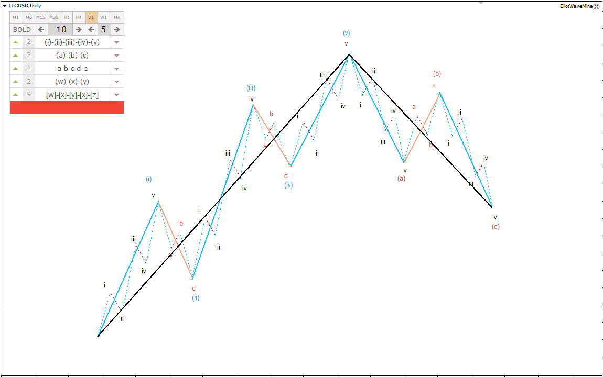

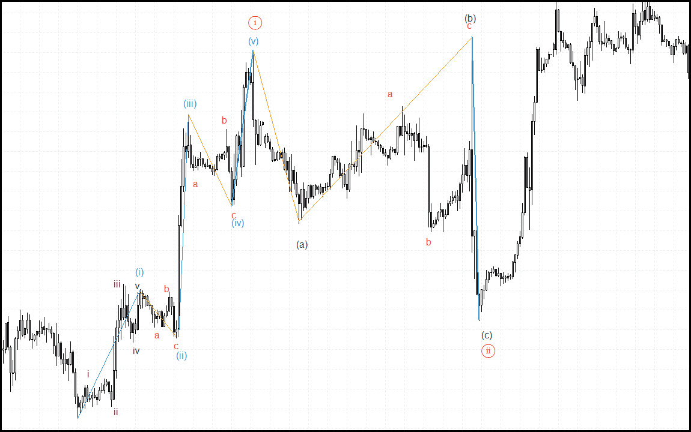

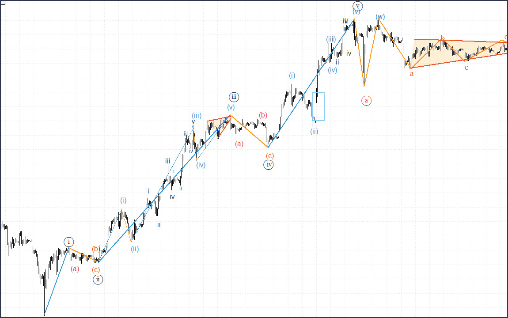

---

## Растяжение в импульсе

Source: <https://traderevolution.by/elliott-wave-principle-basics/motive-wave/impulse-wave-extensions/>

#### Правила & Рекомендации:

* Такие же, как для импульсных формаций:

#### Рекомендации для растяжения:

* Волны 1, 3 и 5 могут подразделяться на подволны и формировать растяжения.
* При растяжении подразделение импульса на подволны преувеличено, что приводит к удлинению импульса.
* Как правило растянута только одна из импульсных волн (1, 3 или 5).
* В случае "Цикла" и Суперцикла" одновременно растянуты и третья и пятая волны.
* Чаще всего растяжения встречаются в третьей и пятой волнах.
* В случае растяжения волны 3, волны 1 и 5 обычно пропорциональны друг другу.
* В случае растяжения волны 1, волна 5 обычно заканчивается на уровене 61.8% расширения фибоначчи от волны 1.
* В случае растяжения волны 5, она обычно заканчивается на уровене 161.8% расширения фибоначчи от волны 3.

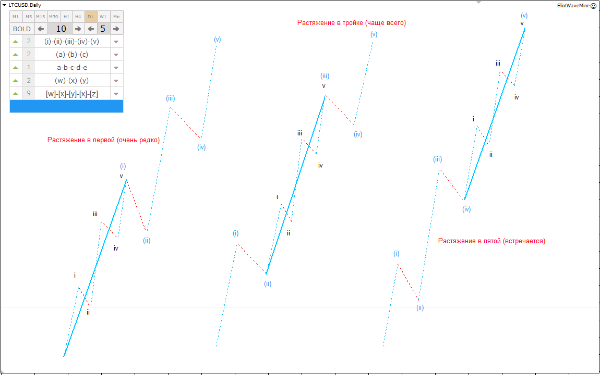

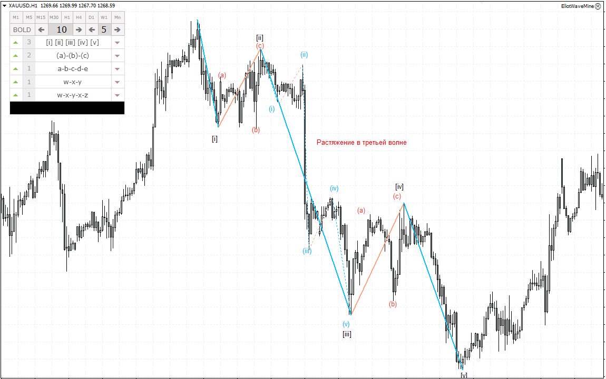

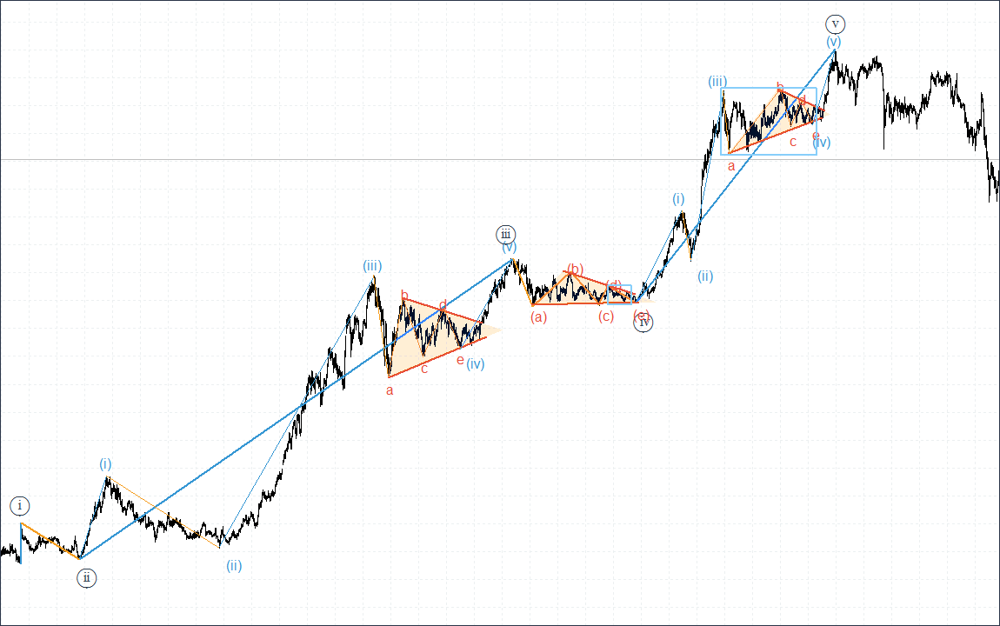

---

## Начальная диагональ

Source: <https://traderevolution.by/elliott-wave-principle-basics/motive-wave/leading-diagonal/>

#### Правила:

* Диагонали всегда подразделяются на пять волн.
* Структура = 3-3-3-3-3 и 5-3-5-3-5. Также встречаются смешанные варианты. Например 5-3-3-3-3 или 3-3-3-3-5
* Начальные диагонали встречаются в 1 волне импульса или в волне A зигзага.
* **Волны 2 и 4 всегда имеют форму зигзагов.**
* Волна 2 НИКОГДА не заходит за основание волны 1.
* Волна 3 должна заходить за окончание волны 1
* **Волна 4 должна заходить в зону волны 1, но не за окончание волны 2. Правило перекрытия должно нарушаться.**
* **Волна 5 должна заходить за окончание волны 3. Усечения в начальной диагонали быть не может.**
* В начальных сужающихся диагоналях волна 3 всегда короче волны 1, волна 4 всегда короче волны 2, а волна 5 всегда короче волны 3.
* В начальных расширяющихся диагоналях волна 3 всегда длиннее волны 1, волна 4 всегда длиннее волны 2, а волна 5 всегда длиннее волны 3.

#### Рекомендации:

* Волны 1, 3 и 5 обычно подразделяются на зигзаги, но также могут быть импульсными волнами.
* Если начальная диагональ появляется в первой волне, то волна 3 как правило растянута.
* Если соединить окончания волн 1-3 и 2-4, то фигура принимает форму сужающегося треугольника(сужающаяся диагональ) или расширяющегося треугольника(расширяющаяся диагональ).
* В сужающейся диагонали волна 5 может оканчиваться за линией построенной по волнам 1-3 ("выброс") .
* В расширенной диагонали, волна 5 может останавливаться не достигая линии построенной по волнам 1-3.

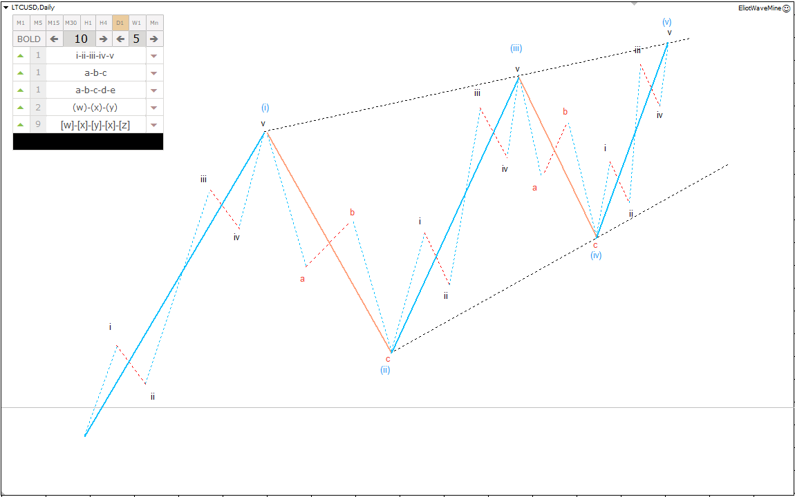

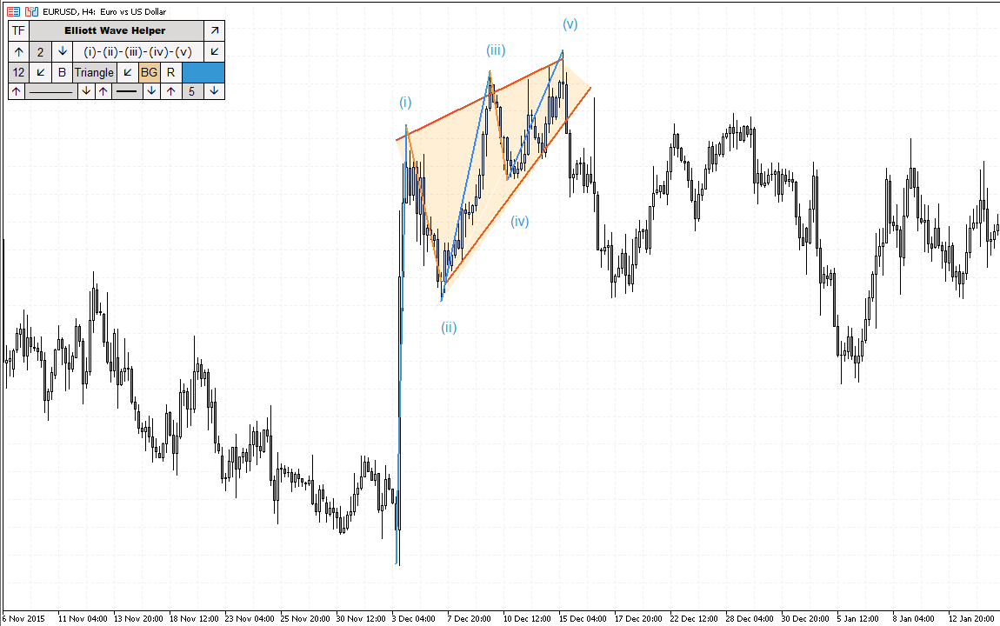

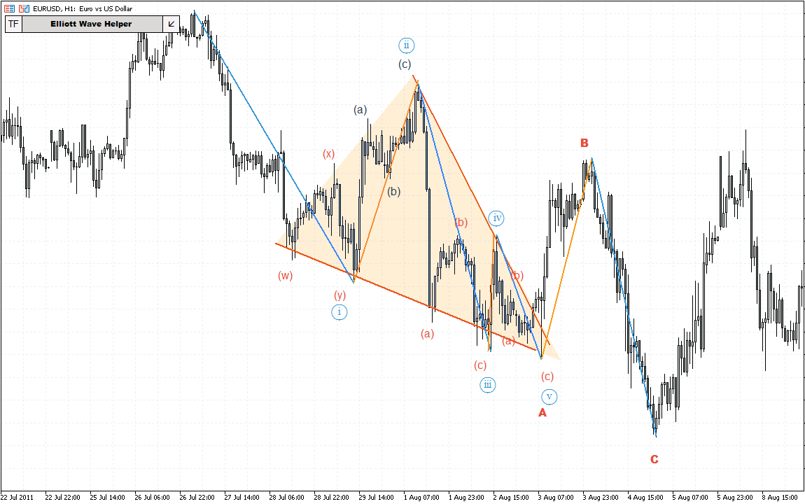

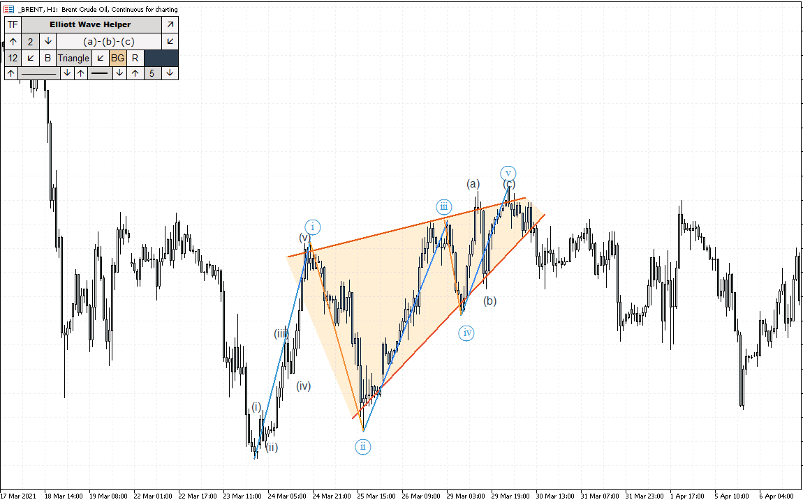

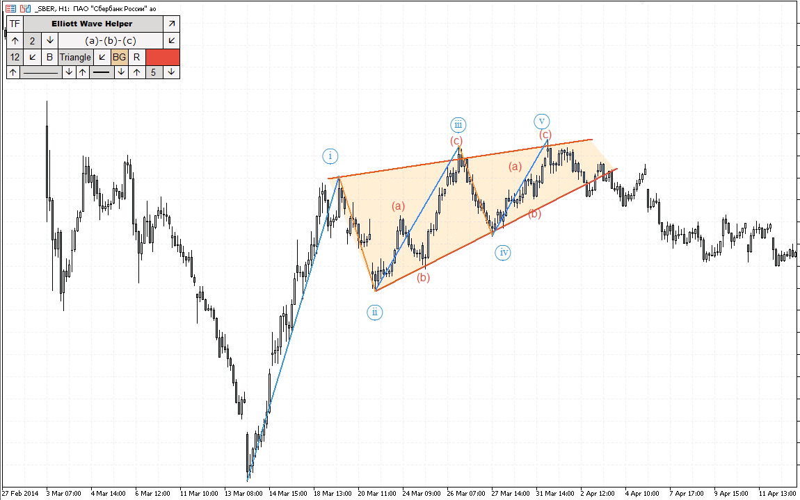

---

## Конечная диагональ

Source: <https://traderevolution.by/elliott-wave-principle-basics/motive-wave/ending-diagonal/>

#### Правила:

* Диагонали всегда подразделяются на пять волн.
* Структура = 3-3-3-3-3
* Конечные диагонали встречаются в 5 волне импульса или в волне C зигзага или флета.
* **Волны 1, 2, 3, 4 и 5 всегда имеют форму зигзагов.**
* Волна 2 НИКОГДА не заходит за основание волны 1.
* Волна 3 должна заходить за окончание волны 1
* **Волна 4 должна заходить в зону волны 1, но не за окончание волны 2. Правило перекрытия должно нарушаться.**
* **Волна 5 может не доходить до окончания волны 3. Возможно усечение.**
* В конечных сужающихся диагоналях волна 3 всегда короче волны 1, волна 4 всегда короче волны 2, а волна 5 всегда короче волны 3.
* В конечных расширяющихся диагоналях волна 3 всегда длиннее волны 1, волна 4 всегда длиннее волны 2, а волна 5 всегда длиннее волны 3.

#### Рекомендации:

* Волны 1, 3 и 5 всегда подразделяются на зигзаги.
* Если соединить окончания волн 1-3 и 2-4, то фигура принимает форму сужающегося треугольника(сужающаяся диагональ) или расширяющегося треугольника(расширяющаяся диагональ).
* В сужающейся диагонали волна 5 может оканчиваться за линией построенной по волнам 1-3 ("выброс") .
* В расширенной диагонали волна 5 может останавливаться не достигая линии построенной по волнам 1-3.

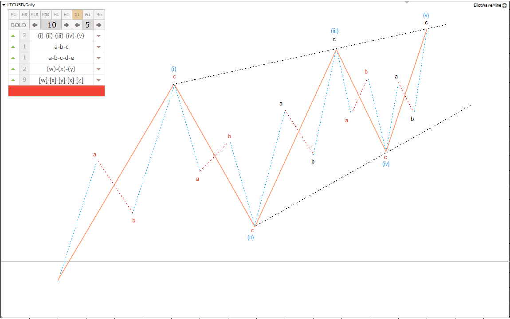

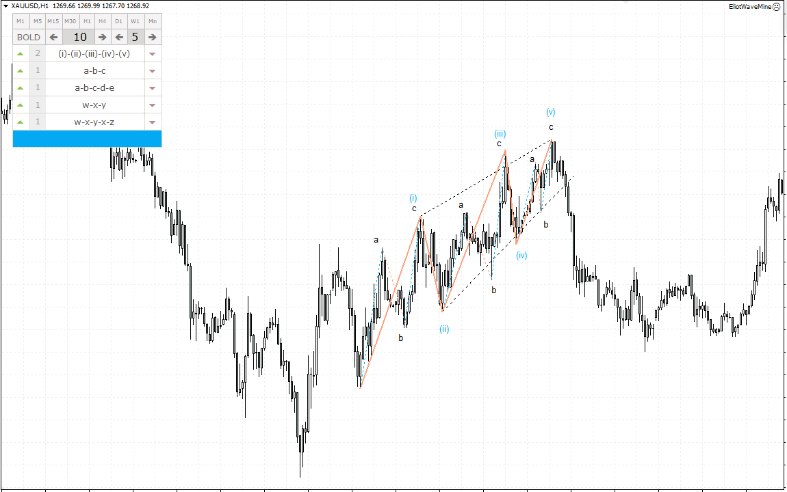

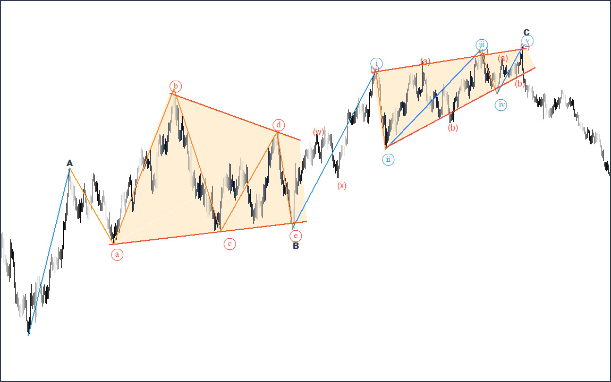

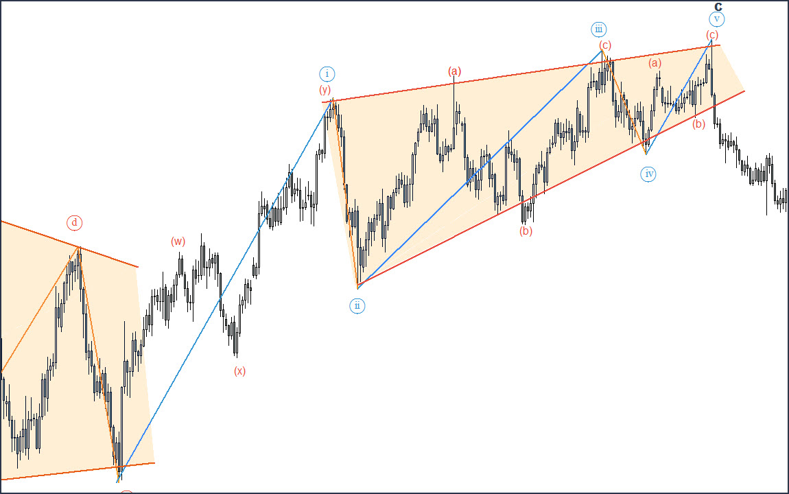

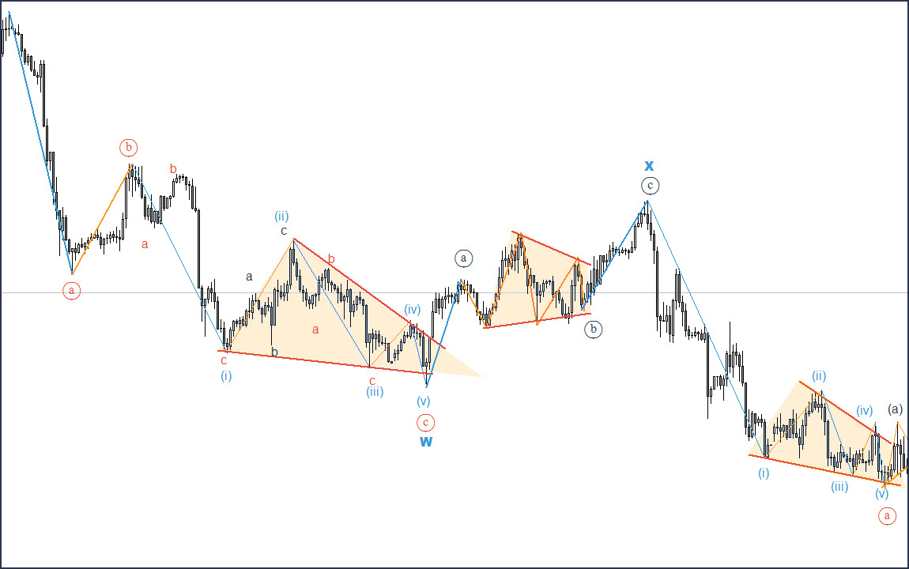

---

## Расширенная диагональ

Source: <https://traderevolution.by/elliott-wave-principle-basics/motive-wave/expanding-diagonal/>

#### Правила:

* Диагонали всегда подразделяются на пять волн.
* Структура = 3-3-3-3-3 для конечной расширенной диагонали
* Структура = 3-3-3-3-3, 5-3-5-3-5, 5-3-3-3-3 для начальной расширенной диагонали
* Конечные диагонали встречаются в 5 волне импульса или в волне C зигзага.
* Начальные диагонали встречаются в 1 волне импульса или в волне A зигзага.
* **Волны 2 и 4 всегда имеют форму зигзагов.**
* Волна 2 НИКОГДА не заходит за основание волны 1.
* Волна 3 должна заходить за окончание волны 1
* **Волна 4 должна заходить в зону волны 1, но не за окончание волны 2. Правило перекрытия должно нарушаться.**
* **Волна 5 должна заходить за окончание волны 3. Усечения в расширенной диагонали быть не может.**
* В конечных/начальных сужающихся диагоналях волна 3 всегда короче волны 1, волна 4 всегда короче волны 2, а волна 5 всегда короче волны 3.
* В конечных/начальных расширяющихся диагоналях волна 3 всегда длиннее волны 1, волна 4 всегда длиннее волны 2, а волна 5 всегда длиннее волны 3.

#### Рекомендации:

* В импульсе если волна 3 не растянута, волна 5 вряд ли примет форму конечной диагонали.
* Если соединить окончания волн 1-3 и 2-4, то фигура принимает форму сужающегося треугольника(сужающаяся диагональ) или расширяющегося треугольника(расширяющаяся диагональ).
* В сужающейся диагонали волна 5 иногда может оканчивается за линией построенной по волнам 1-3 ("выброс") .
* В расширенной диагонали волна 5 может останавливаться не достигая линии построенной по волнам 1-3.

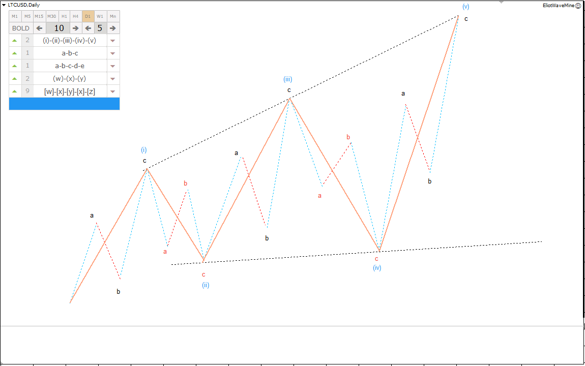

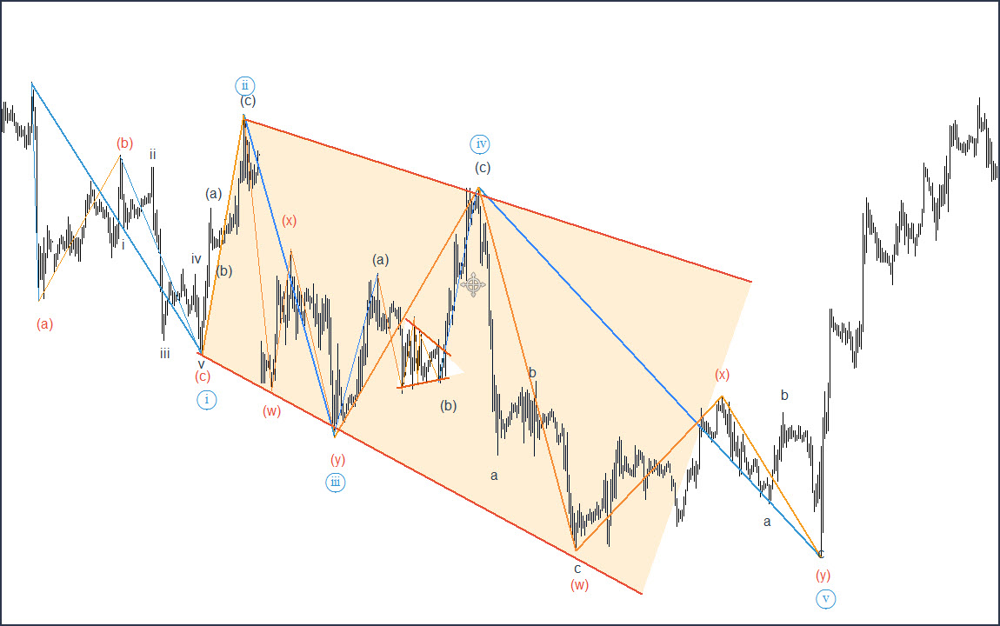

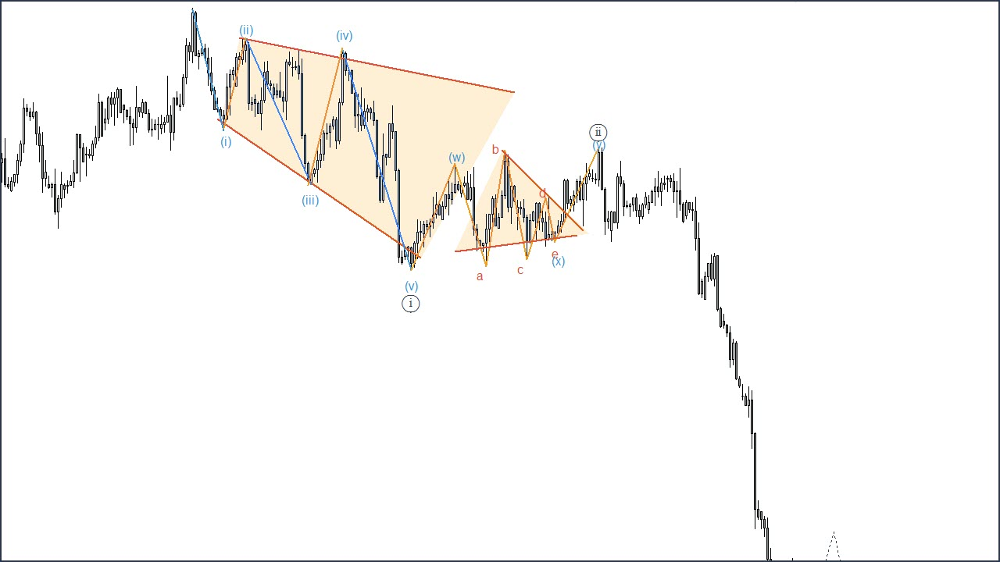

---

## Усечение

Source: <https://traderevolution.by/elliott-wave-principle-basics/motive-wave/usechenie/>

#### Рекомендации:

* Усечение встречается в пятой волне импульса и в пятой волне сужающейся конечной диагонали.
* Правила импульса распространяются и на усеченный импульс.
* Усечение в пятой волне формирует фигуру технического анализа "Двойная вершина" для восходящего импульса и "Двойное дно" для нисходящего импульса.
* Усечение не встречается в зигзагах или двойных зигзагах.
* Усечение встречается на графиках в крайне редких случаях.
* Общая длина импульсной волны определяется не по локальному максимуму или минимуму, а по окончанию усеченной волны 5.

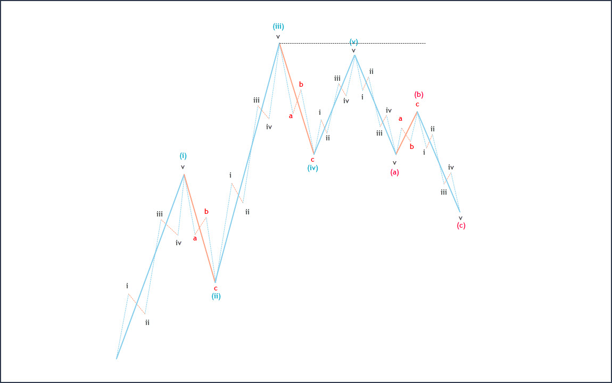

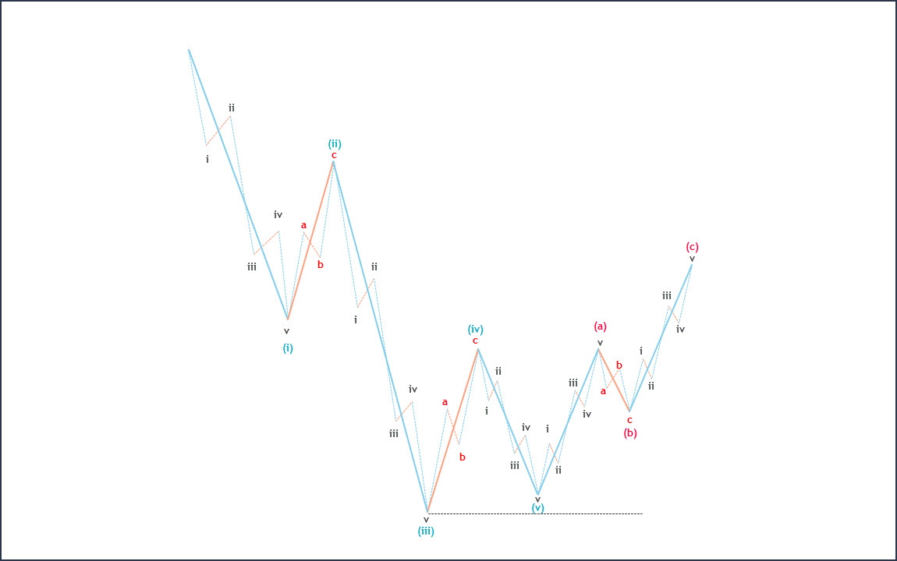

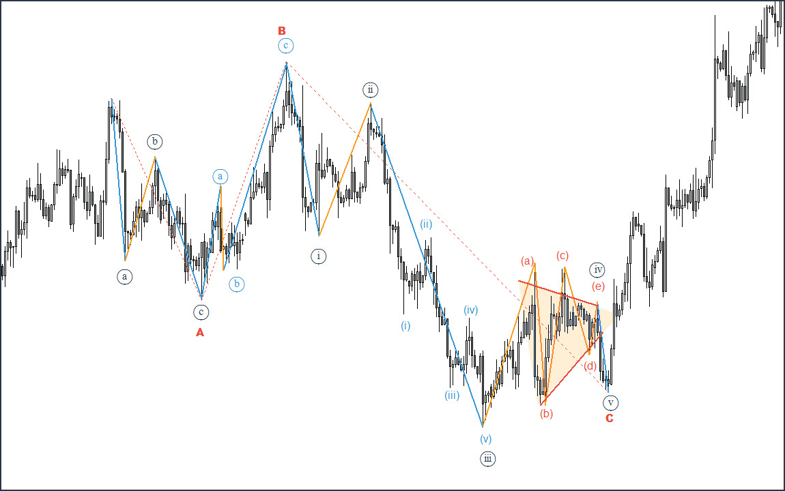

---

# Коррекции

## Зигзаг

Source: <https://traderevolution.by/elliott-wave-principle-basics/corrective-wave/zigzag/>

#### Правила:

* Может встречаться в волнах 2 и 4 импульса, в волне B зигзага, в волнах A и B плоскости, в волнах A,B,C,D,E треугольника, в волнах W,X,Y,X,Z комбинации, в волнах 1,2,3,4,5 начальной или конечной диагонали.
* Зигзаг всегда имеет трёх волновую структуру..
* Структура = 5-3-5
* Волна B никогда не заходит за начало волны A..
* Волна B может быть любым трёх волновым паттерном: флэтом, зигзагом, треугольником либо комбинацией..
* Волна A может быть импульсом или начальной диагональю.
* Волна С может быть импульсом или конечной диагональю.
* Волна С всегда оканчивается ниже окончания волны А.

#### Рекомендации:

* Линия построенная по окончаниям волн A - C как правило параллельна линии построенной от начала волны A до окончания волны B. Важно\*!
* Волны A и С как правило эквивалентны по длине.
* Чаще всего волны А и С являются импульсами..

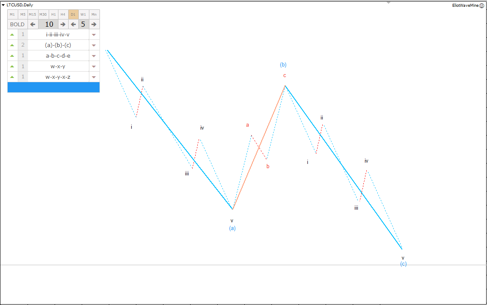

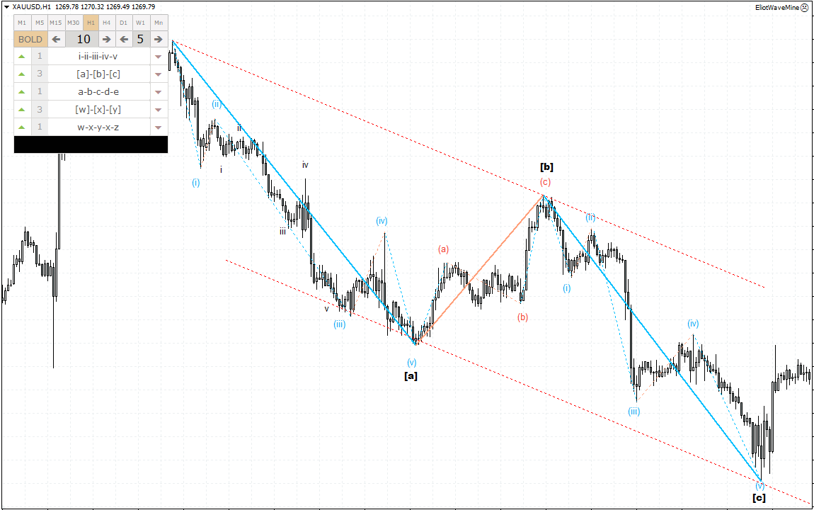

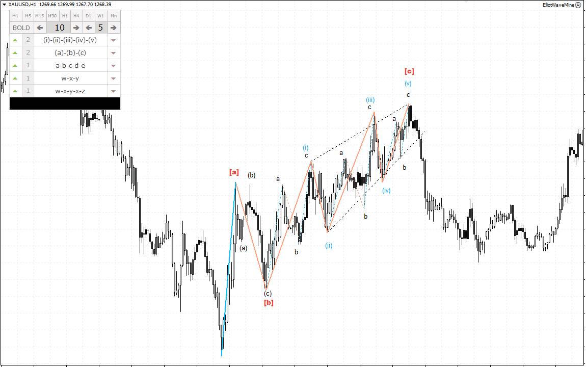

---

## Двойной зигзаг

Source: <https://traderevolution.by/elliott-wave-principle-basics/corrective-wave/dvoynoy-zigzag/>

#### Правила:

* Может встречаться в волнах 2 и 4 импульса, в волне B зигзага, в волнах A и B плоскости, в волнах A,B,C,D,E треугольника, в волне X комбинации, в волнах 1,2,3,4,5 начальной или конечной диагонали.
* Двойной зигзаг всегда имеет трёх волновую структуру..
* Структура = 3-3-3.
* Волна X никогда не заходит за начало волны W..
* Волна X может быть любым трёх волновым паттерном: флэтом, зигзагом, треугольником либо комбинацией.
* Волна W может быть только зигзагом.
* Волна Y может быть только зигзагом.
* Волна Y всегда оканчивается ниже окончания волны W.
* Не бывает комбинаций внутри волн W и Y. Например не может быть W-X-Y внутри W или Y.

#### Рекомендации:

* Линия построенная по окончаниям волн W - Y как правило параллельна линии построенной от начала волны W до окончания волны X. Важно\*!
* Волны W и Y как правило эквивалентны по длине.
* Волны W и Y всегда зигзаги.

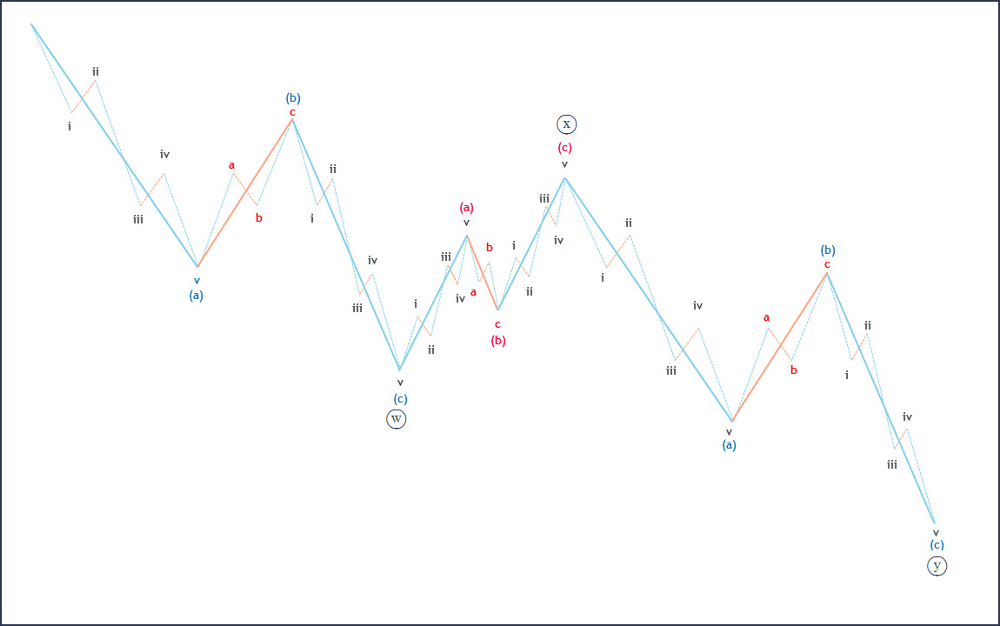

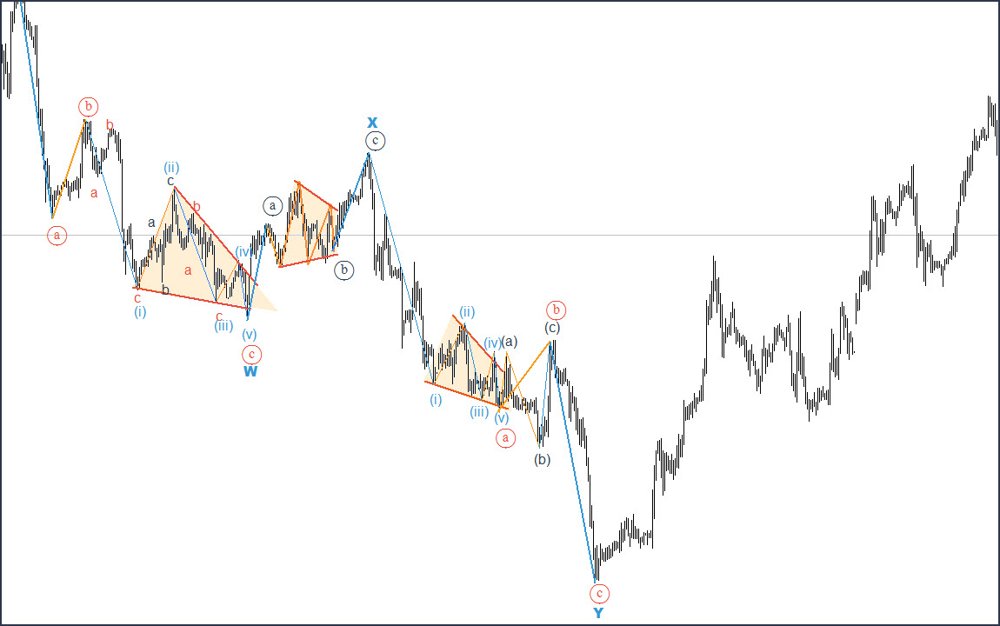

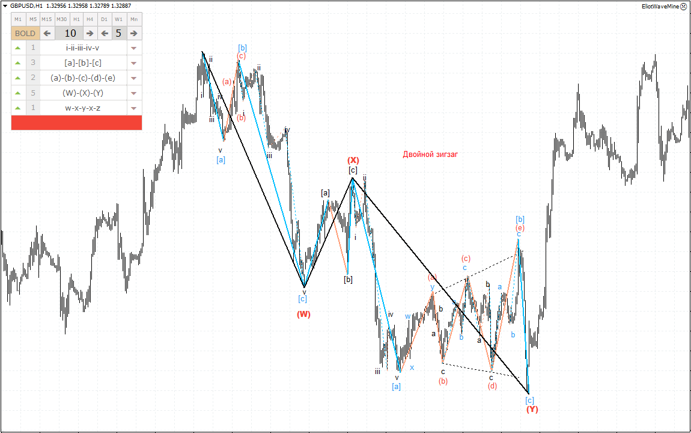

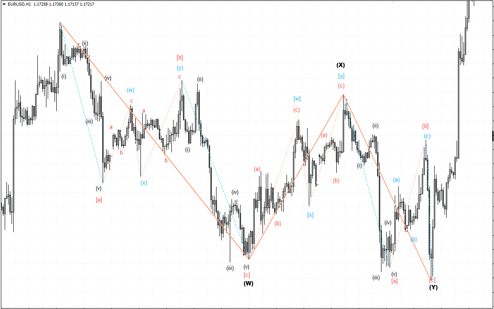

---

## Обычный флет

Source: <https://traderevolution.by/elliott-wave-principle-basics/corrective-wave/regular-flat/>

#### Правила:

* Описан тут только для того, чтобы отдать дань книге Пректера. На практике не встречается никогда. Забудьте о существовании такой модели, как обычный флет.
* Если встречается, то в волнах 2 и 4 импульса, в волне B зигзага, в волнах A и B плоскости, в волнах W,X,Y,X,Z комбинации. Если речь идёт о комбинации зигзагов, то только в волне X.
* Всегда имеет трёх волновую структуру.
* Структура: 3-3-5.
* Волна А всегда трёх волновая и никогда не бывает треугольником.
* Волна B имеет трёх волновую структуру.
* **Обычно волна В откатывает как минимум 90 процентов от волны А.**
* Волна С имеет пяти волновую структуру. Может быть как импульсом, так и конечной диагональю.

#### Рекомендации:

* Линия построенная по окончаниям волн A - C как правило параллельна линии построенной от начала волны A до окончания волны B.
* Волны A и С как правило эквивалентны по длине.
* Волна С всегда оканчивается около окончания волны А.

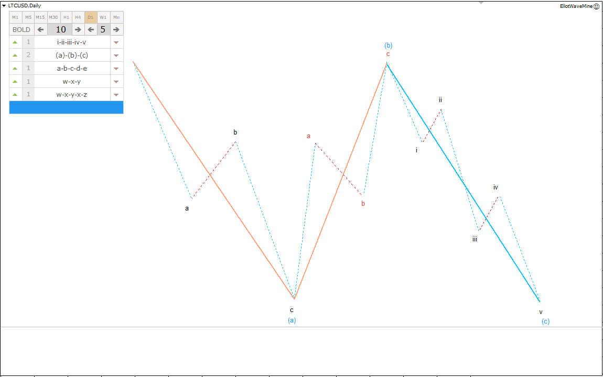

---

## Расширенный флет

Source: <https://traderevolution.by/elliott-wave-principle-basics/corrective-wave/expanded-flat/>

#### Правила:

* Может встречаться в волне 2 и 4 импульса, в волне B зигзага, в волнах A и B плоскости, в волнах W,X,Y,X,Z комбинации. Если речь идёт о комбинации зигзагов, то только в волне X.
* Всегда имеет трёх волновую структуру.
* Структура: 3-3-5.
* Волна А всегда трёх волновая и никогда не бывает треугольником.
* Волна B имеет трёх волновую структуру.
* **Волна В всегда пробивает максимум волны А.**
* **Волна C всегда пробивает минимум волны A.**
* Волна С имеет пяти волновую структуру. Может быть как импульсом, так и конечной диагональю.

#### Рекомендации:

* Волна С чаще всего останавливается между 100 и 161.8 уровнем расширения Фибоначчи от волны А.
* Волны A и С чаще всего не эквивалентны по длине.

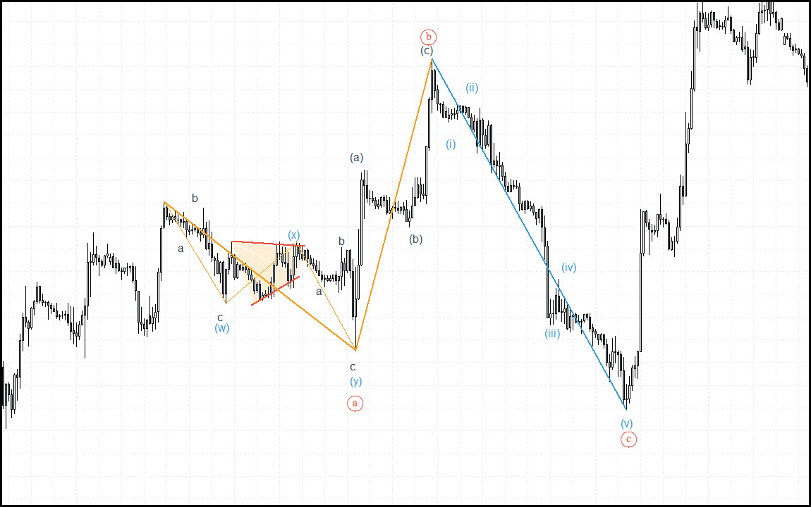

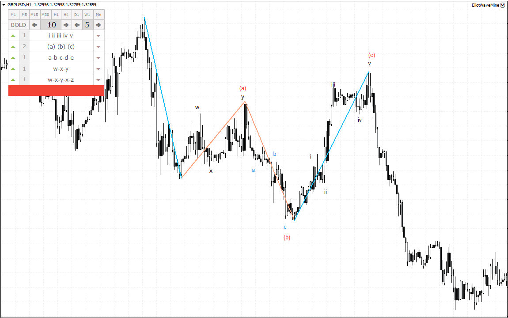

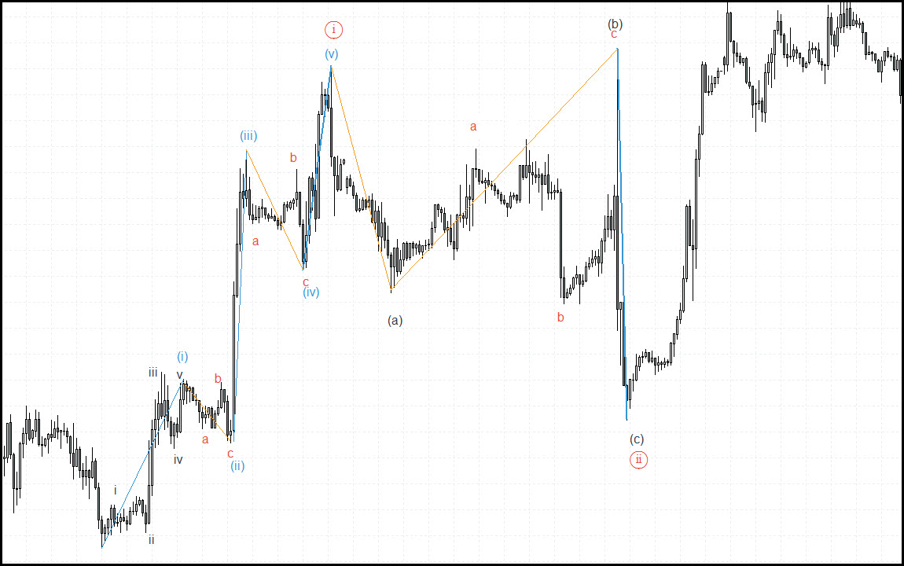

---

## Бегущий флет

Source: <https://traderevolution.by/elliott-wave-principle-basics/corrective-wave/running-flat/>

#### Правила:

* Может встречаться в волне 2 и 4 импульса, в волне B зигзага, в волнах A и B плоскости, в волнах W,X,Y,X,Z комбинации. Если речь идёт о комбинации зигзагов, то только в волне X.
* Всегда имеет трёх волновую структуру.
* Структура: 3-3-5.
* Волна А всегда трёх волновая и никогда не бывает треугольником.
* Волна B имеет трёх волновую структуру.
* **Волна В всегда пробивает максимум волны А.**
* **Волна C не пробивает минимум волны А формируя усечение.**
* Волна С имеет пяти волновую структуру. Может быть как импульсом, так и конечной диагональю.

#### Рекомендации:

* Линия построенная по окончаниям волн A - C как правило параллельна линии построенной от начала волны A до окончания волны B.
* Волны A и С как правило эквивалентны по длине.

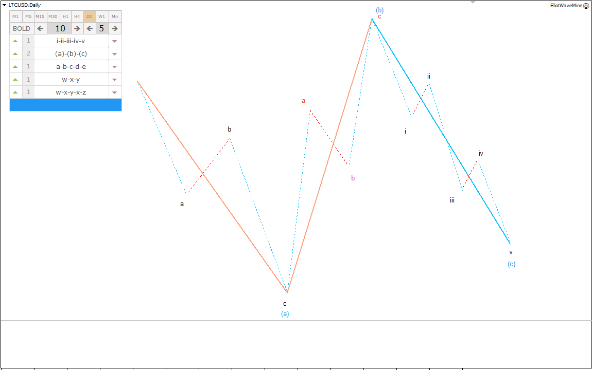

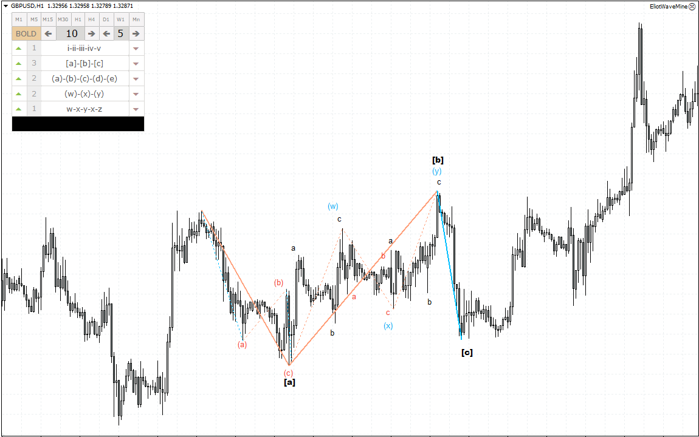

---

## Симметричный треуг

Source: <https://traderevolution.by/elliott-wave-principle-basics/corrective-wave/contracting-triangle/>

#### Правила:

* Может встречаться в волне 4 импульса, в волне B зигзага, в волне X комбинации. Иногда(редко) встречается в волне Y комбинации. Всегда предпоследняя волна. Если речь о W-X-Y-X-Z, то может появиться только во втором X или Z.
* Треугольник подразделяется на пять волн: A, B, C, D, E.
* Структура: 3-3-3-3-3
* Как правило 4 из пяти волн являются зигзагами или комбинацией зигзагов.
* В треугольниках не бывает больше одной комбинационной коррекции (либо одна двойная, либо одна тройная). По моему опыту бывает.
* **В симметричном треугольнике волна C никогда не заходит за окончание волны A, волна D не заходит за окончание волны B, а волна E не заходит за окончание волны C.**
* **В симметричном треугольнике волна E останавливается возле линии A - C треугольника, но также может не добивать или перебивать эту линию.**

#### Рекомендации:

* Волна B может заходить за начало волны А; это встречается не часто и называется бегущий треугольник.
* Симметричный треугольник самый распространённый тип треугольника.

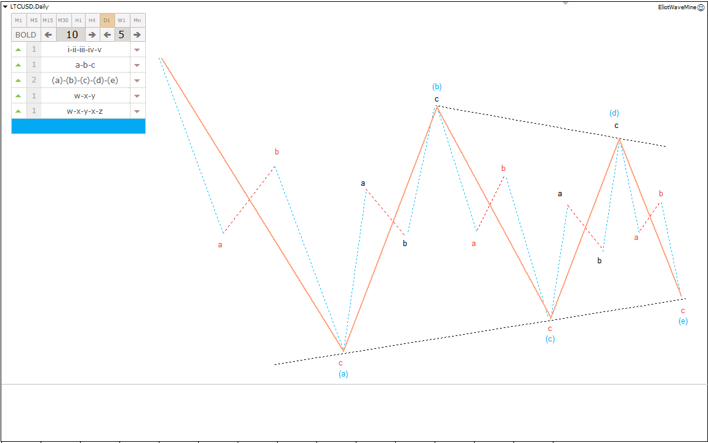

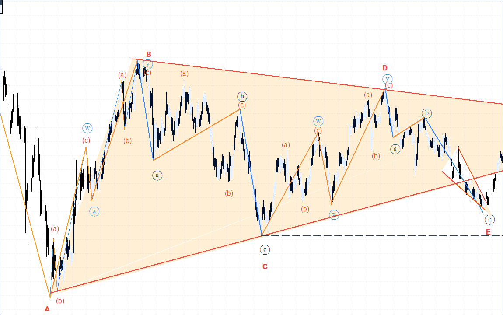

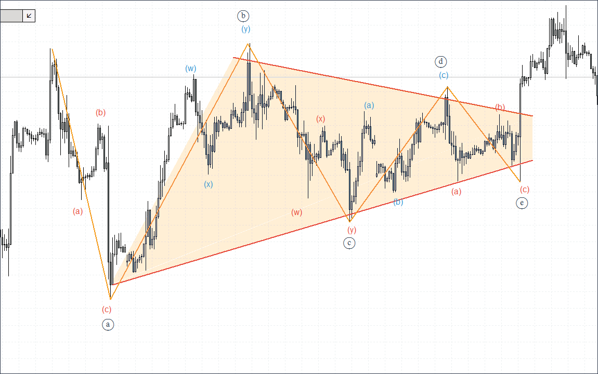

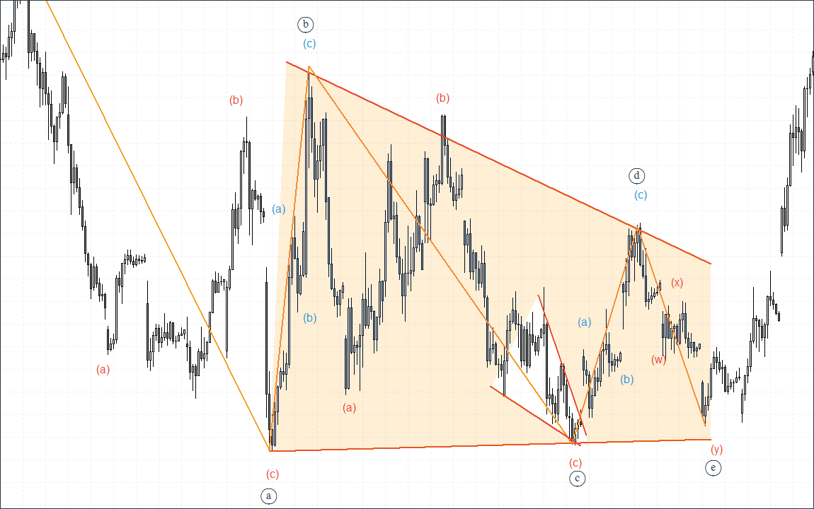

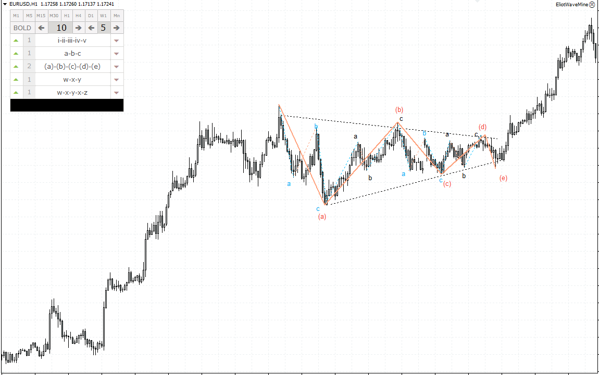

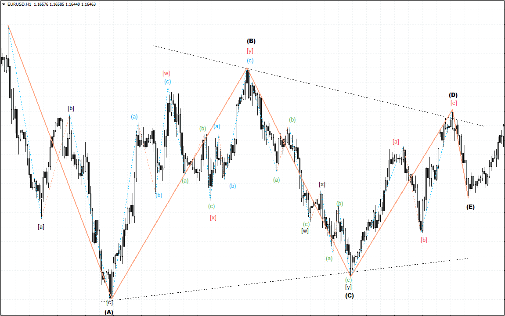

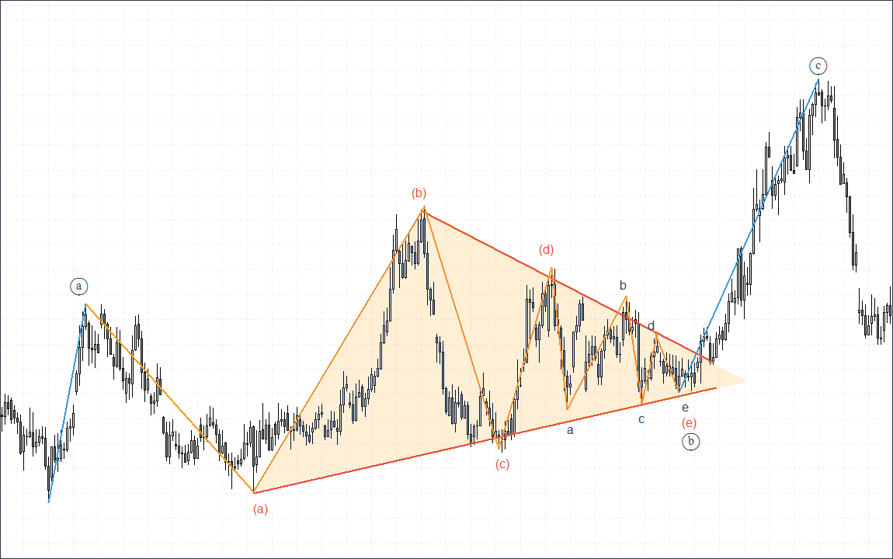

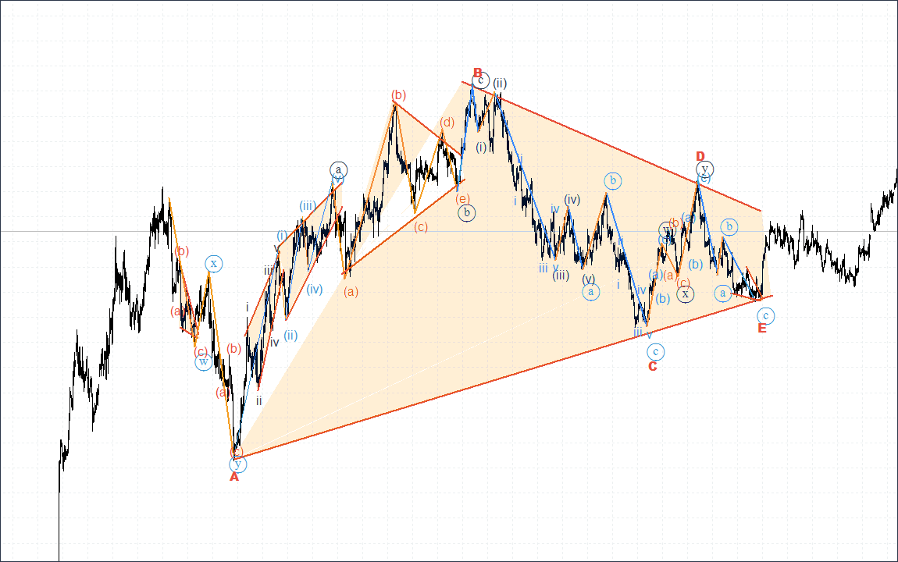

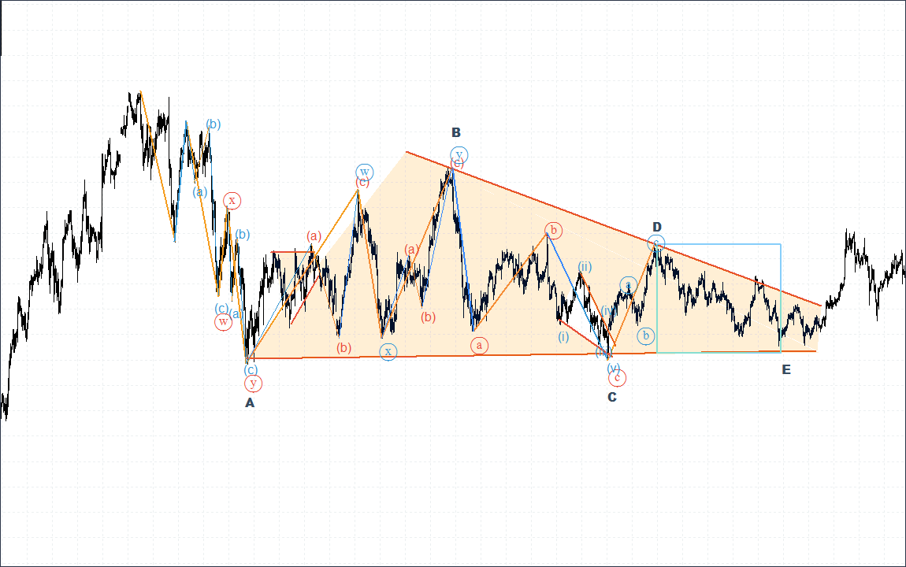

---

## Восходящий треугольник

Source: <https://traderevolution.by/elliott-wave-principle-basics/corrective-wave/barrier-triangle/>

#### Правила:

* Может встречаться в волне 4 импульса, в волне B зигзага, в волне X комбинации. Иногда(редко) встречается в волне Y комбинации. Всегда предпоследняя волна. Если речь о W-X-Y-X-Z, то может появиться только во втором X или Z.
* Треугольник подразделяется на пять волн: A, B, C, D, E.
* Структура: 3-3-3-3-3
* Как правило 4 из пяти волн являются зигзагами или комбинацией зигзагов.
* В треугольниках не бывает больше одной комбинационной коррекции (либо одна двойная, либо одна тройная).
* **В восходящем треугольнике волна C никогда не заходит за окончание волны A, волна E не заходит за окончание волны C.**
* **В восходящем треугольнике волна D останавливается на уровне волны B формируя прямую линию треугольника.**
* **В восходящем треугольнике волна E останавливается возле линии A - C треугольника, но также может не добивать или перебивать эту линию.**

#### Рекомендации:

* Волна B может заходить за начало волны А; это встречается не часто и называется бегущий треугольник.
* Восходящий треугольник встречается реже симметричного треугольника.

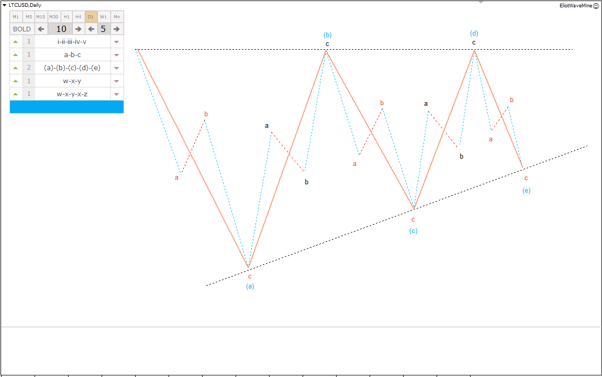

---

## Расширяющийся треугольник

Source: <https://traderevolution.by/elliott-wave-principle-basics/corrective-wave/expanding-triangle/>

#### Правила:

* Может встречаться в волне 4 импульса, в волне B зигзага, в волне X комбинации. Иногда(редко) встречается в волне Y комбинации. Всегда предпоследняя волна. Если речь о W-X-Y-X-Z, то может появиться только во втором X или Z.
* Треугольник подразделяется на пять волн: A, B, C, D, E.
* Структура: 3-3-3-3-3
* Как правило 4 из пяти волн являются зигзагами или комбинацией зигзагов.
* В треугольниках не бывает больше одной комбинационной коррекции (либо одна двойная, либо одна тройная).
* **В расширенном треугольнике волна C заходит за окончание волны A, волна D заходит за окончание волны B, а волна E заходит за окончание волны C.**
* **В расширенном треугольнике волна E останавливается возле линии A - C треугольника, но также может не добивать или перебивать эту линию.**

#### Рекомендации:

* Расширенный треугольник самый редкий тип треугольника.

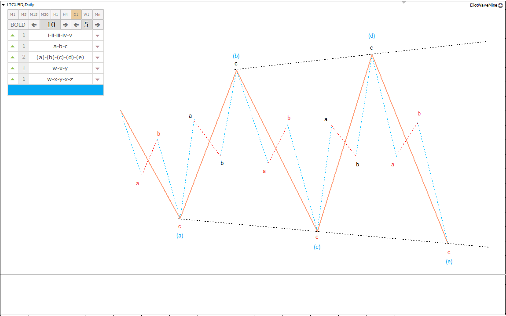

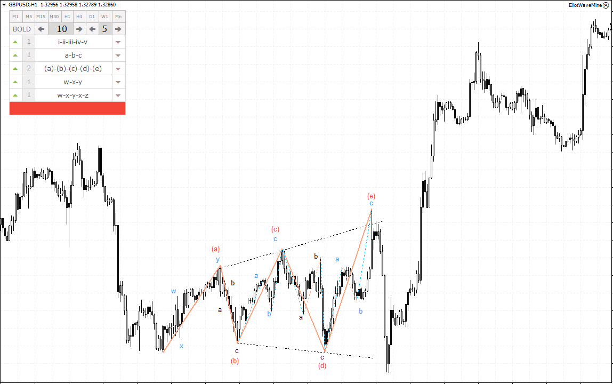

---

## Двойная тройка

Source: <https://traderevolution.by/elliott-wave-principle-basics/corrective-wave/double/>

#### Правила:

* Встречаются в волнах 2(редко), в волнах 4(часто), в волнах B зигзагов, в волнах A и B флетов если речь идёт о комбинации зигзагов. Комбинация зигзагов также может встречаться в волне X комбинации на уровень старше.
* Не бывает комбинации внутри волн W, Y и Z. Т.е. не бывает комбинаций внутри комбинаций.
* Двойные тройки сделаны из двух коррекционных  паттернов связанных коррекционной структурой идущей в противоположном направлении. Отмечается как X.
* Первый коррекционный паттерн в рамках двойной тройки отмечается как W, второй как Y. Паттерны W и Y однонаправленны и соединяются волной X. В результате получается W - X - Y.
* Два зигзага в комбинации объединяются в двойной зигзаг.
* Двойной зигзаг может зянять место одинарного в коррекционном движении (волне X).
* Двойная тройка может быть любой комбинацией из следующих: зигзаг и флэт; флэт и флэт; флэт и зигзаг; флэт и треугольник; зигзаг и треугольник.

#### Рекомендации:

* Комбинации можно предположить когда коррекция в виде флэта или зигзага выглядит существенно меньше, чем импульс, который она корректирует. В результате может образоваться комбинация.

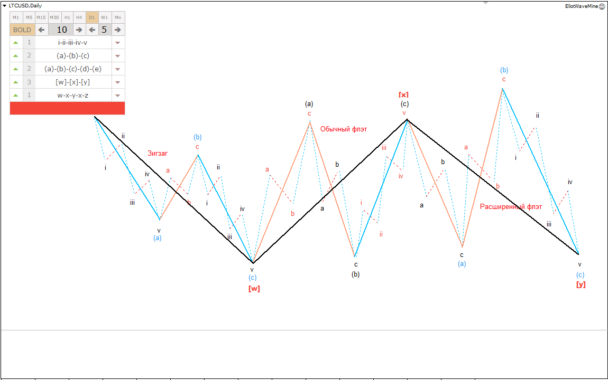

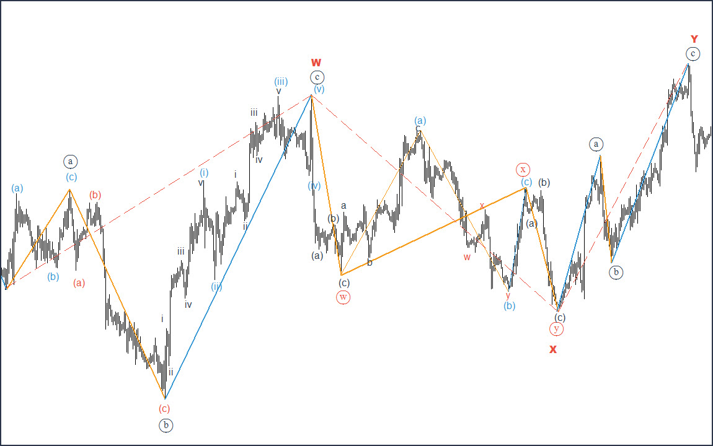

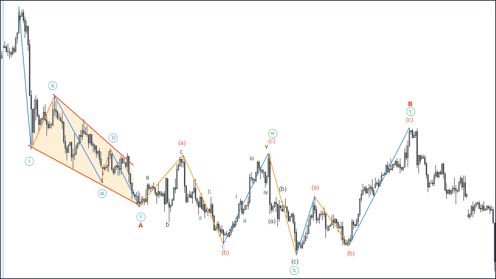

---

## Тройная тройка

Source: <https://traderevolution.by/elliott-wave-principle-basics/corrective-wave/triple/>

#### Правила:

* Крайне редкая модель. Не встречается практически никогда.
* Тройные тройки сделаны из трёх коррекционных паттернов связанных двумя коррекционными идущими в противоположном направлении (отмечаются как X).
* Первый паттерн в рамках коррекционной тройки отмечается как W, второй как Y и третий как Z. Паттерны W - Y - Z однонаправленны и соединяются двумя коррекционными волнами X. Первый X корректирует волну W, а второй X волну Y. В результате получается W - X - Y - X - Z.
* Три зигзага в комбинации объединяются в тройной зигзаг.
* Тройной зигзаг может зянять место одинарного в коррекционном движении (Волне X).
* Комбинация из трёх флэтов встречается редко.

#### Рекомендации:

* Комбинации можно предположить когда коррекция в виде флэта или зигзага выглядит существенно меньше, чем импульс, который она корректирует. В результате может образоваться комбинация.

---

# Прочее

## Ортодоксальные точки

Source: <https://traderevolution.by/elliott-wave-principle-basics/other/other/>

#### Правила:

* Ортодоксальные точки – уровни окончания коррекционных или импульсных паттернов, которые не являются локальными максимумами или минимумами.
* Встречаются в плоскостях, треугольниках, импульсах и конечных диагоналях в случае их усечения, комбинациях.
* Общее окончание коррекционной или импульсной модели определяется по ортодоксальным точкам.
* Уровни Фибоначчи строятся только по ортодоксальным точкам.
* Волновой подсчёт начинается не от локальных максимумов или минимумов, а от ортодоксальных точек.

---

## Чередование в коррекциях

Source: <https://traderevolution.by/elliott-wave-principle-basics/other/fibonach/>

#### Правила:

* Если волна 2 импульса представляет из себя глубокую коррекцию(зигзаг, двойной зигзаг), вероятней всего 4 волна окажется плоской(плоскость, треугольник, комбинация) и наоборот.
* Чаще всего 2 волна является глубокой коррекцией(зигзаг, двойной зигзаг), а 4 плоской(плоскость, треугольник, комбинация).
* В диагональом треугольнике не бывает чередования между 2 и 4.

---

## Чередование в импульсах

Source: <https://traderevolution.by/elliott-wave-principle-basics/other/cheredovanie-v-impulsakh/>

#### Правила:

* Если 1 волна растянута, то 3 и 5 волны скорей всего будут простыми.
* Если 3 волна растянута, то 5 волна скорей всего будет простой и напоминать 1 волну.
* Если 1 и 3 волны не растянуты, скорей всего растяжение можно ожидать в 5 волне.

---

## Дивергенция

Source: <https://traderevolution.by/elliott-wave-principle-basics/other/divergentsiya/>

#### Правила:

* Самый большой пик индикатора MACD или AO говорит о том, что там закончилась третья волна. Или иногда растянутая 5.
* Между 3 и 5 волнами чаще всего формируется дивергенция.
* Дивергенция также может сформироваться между волнами A и C зигзага или W и Y двойного зигзага.
* Дивергенция это один из самых сильных сигналов разворота.
* Дивергенцию нужно искать в кластерных зонах.

---

# Фибоначчи

## Сетка Коррекции

Source: <https://traderevolution.by/elliott-wave-principle-basics/fibonachchi/setka-korrektsii/>

#### Правила:

* Для определения окончания коррекции сетка Фибоначчи тянется от минимума(точка 1) до максимума(точка 2) импульса для восходящей модели или от максимума(точка 1) до минимума(точка 2) импульса для нисходящей модели.
* Глубокие коррекции откатывают чаще всего 61.8%. Реже 50%, 78.6%.
* Плоские коррекции откатывают чаще всего 38.2%. Реже 23.6%, 50%.

---

## Сетка Импульсы

Source: <https://traderevolution.by/elliott-wave-principle-basics/fibonachchi/setka-impulsy/>

#### Правила:

* Для определения окончания восходящего импульса(волна 3 или C), Сетка Фибоначчи тянется от максимума коррекции 1 или A(точка 1) до минимума коррекции 2 или B(точка 2).
* Для определения окончания нисходящего импульса(волна 3 или C), Сетка Фибоначчи тянется от минимума коррекции 1 или A(точка 1) до максимума коррекции 2 или B(точка 2).
* Если речь об определении окончания волны C зигзага, то нас интересует 127.2%, 161.8%. Реже 200 и выше.
* Чем меньше откатывает волна B зигзага по отношению к волне A зигзага, тем дальше от её окончания оканчивается волна C, соответственно тем больше уровень цели по фибоначчи.
* Цели в комбинации зигзагов определяются также, как в зигзагах.
* Если речь об определении окончания волны 3 импульса, то нас интересуют уровни 161.8%, 200%, 261.8% и т..д.

---

## Расширение Коррекции

Source: <https://traderevolution.by/elliott-wave-principle-basics/fibonachchi/rasshirenie-korrektsii/>

#### Правила:

* Коррекции пропорциональны между собой и соотносятся друг с другом по расстоянию.
* Пропорциональны волны 2 и 4 импульса, A и C треугольника, B и D треугольника, C и E треугольника, а также первый и второй X в комбинации.
* Для определения окончания волны 4 расширение фибоначчи строится по трем точкам: точка 0 - окончание волны 1, точка 1 - завершение волны 2, точка 2 - завершение волны 3.
* 4 волна может равняться 61.8%, 78.6%, 100%, 127.2, 161.8% по отношению ко второй волне.
* Глубокая коррекция к плоской уменьшает уровни, плоская коррекция к глубокой увеличивает уровни.
* Для определения окончания чередующихся волн треугольника логика идентична.
* Для сужающихся треугольников чередующиеся волны соотносятся на уровнях 61.8%, 78.6%.
* Для расширяющихся треугольников чередующиеся волны соотносятся на уровнях 127.2%, 161.8%.

---

## Расширение Импульсы

Source: <https://traderevolution.by/elliott-wave-principle-basics/fibonachchi/rasshirenie-impulsy/>

#### Правила:

* Импульсы пропорциональны между собой и соотносятся друг с другом по расстоянию.
* Пропорциональны волны A и C зигзага или плоскости, 1 и 3 импульса, 1 и 5 импульса, W и Y зигзага или комбинации.
* Для определения окончания восходящего импульса(волна 3 или C) расширение Фибоначчи строится по трём точкам: точка 0 - начало импульса(волны 1 или A), точка 1 - завершение импульса(волны 1 или A), точка 2 - завершение коррекции(волны 2 или B). Работает в обе стороны.
* Для определения окончания волны 5 расширение Фибоначчи строится по трём точкам: точка 0 - начало волны 1, точка 1- окончание волны 1, тока 2 - окончание волны 4.
* Для определения волны C зигзага или волны Y двойного зигзага работают уровни 61.8%, 100%, 127.2%, 161.8%. Чаще всего работает 1 к 1.
* Для волны C расширенного флета чаще всего работает 161.8%.
* Для волны C бегущего флета чаще всего работает 100%.
* Для определения волны 3 импульса работают уровни 161.8%, 200.0%, 261.8% и т. д.
* Для определения волны 5 импульса работают уровни 61.8%, 78.6%, 100%, 161.8%.
* Для сужающихся диагоналей чередующиеся волны соотносятся на уровнях 61.8%, 78.6%.
* Для расширяющихся диагоналей чередующиеся волны соотносятся на уровнях 127.2%, 161.8%.

---

## Кластер

Source: <https://traderevolution.by/elliott-wave-principle-basics/fibonachchi/klasternaya-zona/>

#### Правила:

* Кластер - зона, где сходятся уровни от различных измерений фибоначчи, включая сетку и расширение.
* Как правило строится сразу несколько кластеров, но среди них выделяется один наиболее вероятный.
* Наиболее вероятный кластер складывается из наиболее вероятных значений уровней, которые в него попадают.
* В среднем кластер строится на основе 2х - 3х уровней Фибоначчи.
* Кластер может быть как зоной для входа, так и зоной для выхода.
* В рамках кластера в идеале нужно получить подтверждение разворота. Например паттерн Гартли, дивергенцию, паттерн Price Action.

---

# Карточки

## Волна 1

Source: <https://traderevolution.by/elliott-wave-principle-basics/kartochki/volna-1/>

---

## Волна 2

Source: <https://traderevolution.by/elliott-wave-principle-basics/kartochki/volna-2/>

---

## Волна 3

Source: <https://traderevolution.by/elliott-wave-principle-basics/kartochki/volna-3/>

---

## Волна 4

Source: <https://traderevolution.by/elliott-wave-principle-basics/kartochki/volna-4/>

---

## Волна 5

Source: <https://traderevolution.by/elliott-wave-principle-basics/kartochki/volna-5/>

---

## Волна A

Source: <https://traderevolution.by/elliott-wave-principle-basics/kartochki/volna-a/>

---

## Волна B

Source: <https://traderevolution.by/elliott-wave-principle-basics/kartochki/volna-b/>

---

## Волна C

Source: <https://traderevolution.by/elliott-wave-principle-basics/kartochki/volna-c/>

---

## Волна D

Source: <https://traderevolution.by/elliott-wave-principle-basics/kartochki/volna-d/>

---

## Волна E

Source: <https://traderevolution.by/elliott-wave-principle-basics/kartochki/volna-e/>

---

## Волна W

Source: <https://traderevolution.by/elliott-wave-principle-basics/kartochki/volna-w/>

---

## Волна X

Source: <https://traderevolution.by/elliott-wave-principle-basics/kartochki/volna-x/>

---

## Волна Y

Source: <https://traderevolution.by/elliott-wave-principle-basics/kartochki/volna-y/>

---

